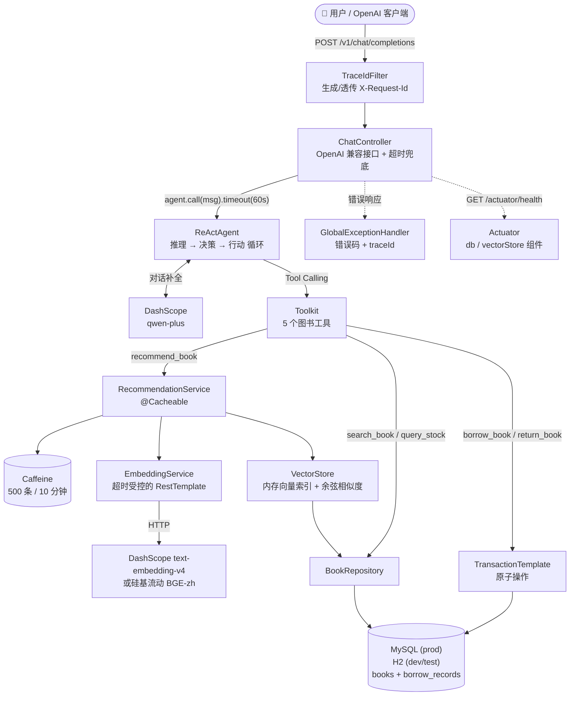

# Smart Library Agent

基于 **Spring Boot + AgentScope** 的智能图书馆助手。用 ReAct 架构让大模型自主调度五个图书工具，内置基于向量检索的语义推荐（RAG），并提供 OpenAI 兼容的对话接口。

[](https://github.com/yelaing/smart-library-agent/actions/workflows/ci.yml)
[](https://adoptium.net/)
[](https://spring.io/projects/spring-boot)
[](https://github.com/agentscope-ai/agentscope-java)
[](#测试与代码质量)

## 核心亮点

- **RAG 语义推荐** —— 图书简介经 Embedding 向量化后存内存索引，用户说"想学并发编程"时按余弦相似度检索最相关的馆藏，而不是做关键词匹配；低于相似度阈值的命中会被丢弃，宁可如实说"没有相关馆藏"也不拿无关图书凑数
- **ReAct 推理 + 5 Tool Calling** —— Agent 自主判断意图，在 `recommend_book` / `search_book` / `query_stock` / `borrow_book` / `return_book` 之间调度
- **事务一致性** —— 借书（改状态 + 建记录）与还书（改状态 + 补归还时间）在 `TransactionTemplate` 中原子执行
- **OpenAI 兼容 API** —— `POST /v1/chat/completions` 支持流式与非流式，可直接接入任何兼容 OpenAI 协议的前端
- **会话隔离** —— agent 实例按 `X-Session-Id` 分配而非容器单例，每个会话独立记忆；不传该头时走无状态单轮，避免不同读者互相污染上下文
- **工程化** —— CI（编译 / Checkstyle / 测试 / 覆盖率门禁 / 镜像构建）、多阶段 Docker、Swagger UI、Actuator、traceId 贯穿日志、90%+ 测试覆盖

## 架构


> 图中除 `Agent → LLM → Toolkit` 构成 ReAct 循环（推理、调用工具、再推理直至给出回答）外，其余均为单向调用。

## 技术选型理由

| 选择 | 理由 |
|------|------|
| **AgentScope** 而非 Spring AI / LangChain4j | 原生 Java ReAct 实现，工具注册模型清晰；不引入 Python 侧依赖 |
| **H2 (dev/test) + MySQL (prod) 双栈** | 本地零依赖即可开发调试（H2 文件库，重启不丢数据），生产走 MySQL 并显式配置连接池 |
| **Caffeine** 而非 Redis | 向量索引本身就在 JVM 内（`VectorStore` 是内存 Map），缓存与之一致放在进程内；引入 Redis 会带来与单实例架构不匹配的额外基础设施 |
| **独立 `RecommendationService`** | `LibraryTool` 由 `AgentConfig` 手工 `new` 出来、不是容器管理的 Bean，`@Cacheable` 对它不生效（Spring AOP 只代理 Bean）。把推荐逻辑抽成 `@Service` 后缓存才真正工作，业务逻辑也能绕开 LLM 单测 |
| **`TransactionTemplate`** 而非 `@Transactional` | 工具类非 Spring Bean，注解式事务同样不生效；编程式事务语义显式、不依赖代理 |
| **Checkstyle 务实规则集** | 只拦截命名、导入、括号、复杂度等真问题；不强制 Javadoc、放行测试的 given-when-then 下划线命名与紧凑访问器写法 |

## 快速开始

### 方式一：Docker Compose（一键启动，含 MySQL）

```bash
git clone https://github.com/yelaing/smart-library-agent.git
cd smart-library-agent

cp .env.example .env
# 编辑 .env，至少填入 DASHSCOPE_API_KEY

docker-compose up -d
```

启动后：

| 地址 | 说明 |
|------|------|
| http://localhost:8080/swagger-ui.html | 接口文档与在线调试 |
| http://localhost:8080/actuator/health | 健康检查（含数据库与向量索引状态） |
| http://localhost:8080/actuator/metrics | 指标（JVM、HikariCP、缓存等） |

> `DASHSCOPE_API_KEY` 是**必填**项：五个图书工具只通过 LLM tool calling 暴露，没有其它 HTTP 入口，
> 少了它服务不提供任何功能，因此程序会在启动时直接拒绝并给出提示（而非启动后才在每次对话时 401）。

### 方式二：本地 Maven（H2 文件库，无需 MySQL）

```bash
# 默认就是 dev profile，走 H2 文件库
mvn spring-boot:run

# 或者显式指定
mvn spring-boot:run -Dspring-boot.run.profiles=dev
```

Windows 下也可直接双击 `start.bat`（会自动设置 dev profile 并打开浏览器）。

开发模式下 H2 控制台位于 http://localhost:8080/h2-console （JDBC URL `jdbc:h2:file:./data/library`，用户名 `sa`，密码留空）。

### 验证

```bash
# 健康检查
curl http://localhost:8080/actuator/health

# 非流式对话
curl -X POST http://localhost:8080/v1/chat/completions \
  -H "Content-Type: application/json" \
  -d '{"model":"qwen-plus","messages":[{"role":"user","content":"搜索 Spring 相关的书"}]}'

# 流式对话（SSE，以 [DONE] 结束）
curl -N -X POST http://localhost:8080/v1/chat/completions \
  -H "Content-Type: application/json" \
  -d '{"model":"qwen-plus","stream":true,"messages":[{"role":"user","content":"想学并发编程，推荐几本书"}]}'

# 借书 → 还书（走事务）
curl -X POST http://localhost:8080/v1/chat/completions \
  -H "Content-Type: application/json" \
  -d '{"model":"qwen-plus","messages":[{"role":"user","content":"借阅 ISBN 9787111636996，借阅人张三"}]}'
curl -X POST http://localhost:8080/v1/chat/completions \
  -H "Content-Type: application/json" \
  -d '{"model":"qwen-plus","messages":[{"role":"user","content":"归还 ISBN 9787111636996"}]}'
```

## API 说明

| 方法 | 路径 | 说明 |
|------|------|------|
| POST | `/v1/chat/completions` | OpenAI 兼容对话接口，`stream` 控制流式 |
| POST | `/api/health` | 轻量健康检查（返回服务名与 agent 名） |
| GET | `/actuator/health` | 完整健康检查：`db`、`diskSpace`、`vectorStore` 等组件 |
| GET | `/actuator/metrics` | 指标列表，如 `cache.size`、`hikaricp.connections` |
| GET | `/v3/api-docs` | OpenAPI 3 文档（JSON） |
| GET | `/swagger-ui.html` | Swagger UI |

### 请求示例

```json
{
  "model": "qwen-plus",
  "stream": false,
  "messages": [
    {"role": "user", "content": "想学并发编程，推荐几本书"}
  ]
}
```

多轮对话需在请求头带上 `X-Session-Id`：同一 sessionId 复用同一份对话记忆，
不同 sessionId 互不可见。不带该头时按无状态单轮处理（不保留历史）。

```bash
curl -X POST http://localhost:8080/v1/chat/completions \
  -H "Content-Type: application/json" \
  -H "X-Session-Id: reader-1001" \
  -d '{"model":"qwen-plus","messages":[{"role":"user","content":"想学并发编程"}]}'
```

### 错误响应

所有错误统一为如下结构，`traceId` 与日志中的 `[traceId]` 一一对应，便于按 id 定位问题：

```json
{
  "timestamp": "2026-09-24T05:20:00Z",
  "status": 400,
  "code": 40001,
  "error": "Bad Request",
  "message": "messages 不能为空",
  "traceId": "a1b2c3d4e5f60718",
  "path": "/v1/chat/completions"
}
```

| 错误码 | HTTP | 触发场景 |
|--------|------|----------|
| `40001` INVALID_REQUEST | 400 | `messages` 为空、最后一条用户消息为空白，或请求体不是合法 JSON |
| `40401` NOT_FOUND | 404 | 请求路径不存在 |
| `40501` METHOD_NOT_ALLOWED | 405 | HTTP 方法不被该路径支持（如用 GET 调用只接受 POST 的接口） |
| `41501` UNSUPPORTED_MEDIA_TYPE | 415 | 请求体 Content-Type 不被支持 |
| `50401` AGENT_TIMEOUT | 504 | Agent 调用超过 `library.chat.timeout`（默认 60s） |
| `50000` INTERNAL_ERROR | 500 | 未预期的服务端异常（对外只给统一话术，细节仅进日志） |

## Agent 工具集

| 工具 | 说明 | 示例提问 |
|------|------|----------|
| `recommend_book` | 语义检索推荐（RAG） | "想学并发编程的书" |
| `search_book` | 按书名关键词模糊搜索 | "搜索 Spring 相关的书" |
| `query_stock` | 按 ISBN 精确查库存与位置 | "查 ISBN 9787111636996" |
| `borrow_book` | 借阅图书（事务） | "借阅 ISBN xxx，借阅人张三" |
| `return_book` | 归还图书（事务） | "归还 ISBN xxx" |

## 配置管理

配置按环境拆分，敏感信息全部走环境变量：

| 文件 | 用途 | 数据源 |
|------|------|--------|
| `application.yml` | 公共配置（端口、Cache、Actuator、springdoc、Agent 提示词） | — |
| `application-dev.yml` | 本地开发（`spring.profiles.default` 指向它） | H2 文件库 `./data/library` |
| `application-prod.yml` | 生产 | MySQL，读取 `DB_*` 环境变量 |
| `application-test.yml` | 测试（关闭向量初始化，全离线） | H2 内存库 |

常用环境变量（见 `.env.example`）：

| 变量 | 必填 | 默认 | 说明 |
|------|:---:|------|------|
| `DASHSCOPE_API_KEY` | 是 | — | 百炼 API Key，对话与默认 Embedding 依赖它 |
| `SILICONFLOW_API_KEY` | 否 | 空 | 填入后切换到硅基流动 BGE 中文向量模型 |
| `DB_HOST` / `DB_PORT` / `DB_NAME` | 否 | `localhost` / `3306` / `library` | MySQL 连接（prod） |
| `DB_USERNAME` / `DB_PASSWORD` | 否 | `root` / `root` | MySQL 凭据（prod） |
| `DB_POOL_SIZE` | 否 | `10` | HikariCP 最大连接数 |
| `MYSQL_PASSWORD` | 否 | `root` | docker-compose 中 MySQL root 密码 |
| `SERVER_PORT` | 否 | `8080` | 服务端口 |

可调的应用参数：

| 配置项 | 默认 | 说明 |
|--------|------|------|
| `library.chat.timeout` | `60s` | Agent 单次调用超时上限 |
| `library.embedding.connect-timeout` | `5s` | Embedding 接口连接超时 |
| `library.embedding.read-timeout` | `15s` | Embedding 接口读超时 |
| `library.recommend.min-score` | `0.35` | 语义推荐的余弦相似度下限，低于该值的结果不返回 |
| `library.session.max` | `500` | 内存中保留的会话 agent 实例上限 |
| `library.session.ttl` | `30m` | 会话空闲多久后被回收 |
| `library.vector-init.enabled` | `true` | 是否在启动时构建向量索引 |
| `spring.cache.caffeine.spec` | `maximumSize=500,expireAfterWrite=10m` | 推荐缓存容量与 TTL |

## 数据库

启动时通过 JPA 自动建表，并从 `src/main/resources/books.json` 读入 50 本种子图书（仅当表为空）。
书目外置成数据文件而非硬编码在代码里，现场交付时直接替换这份文件即可换成本馆的真实书目。

- `books`：`isbn` 唯一索引；`title` **刻意不建索引** —— 检索走 `findByTitleContaining` 生成 `LIKE '%关键词%'`，前导通配符无法命中 B-tree 索引
- `borrow_records`：`(book_id, return_date)` 复合索引，服务于还书时的查询

## 测试与代码质量

```bash
mvn test      # 只跑测试
mvn verify    # 编译 + Checkstyle + 测试 + 覆盖率门禁 + 打包（CI 执行的完整流程）
```

| 项 | 现状 |
|------|------|
| 测试数量 | 95（含 1 个默认跳过的规模基准，`-Dbench=true` 触发） |
| 行覆盖率 | **95%**（排除 dto / entity / 启动类） |
| 覆盖率门禁 | 行覆盖 < 80% 则构建失败（`mvn verify`） |
| 代码风格 | Checkstyle 10.26.1，规则集见 `config/checkstyle/checkstyle.xml`，0 违规 |

测试覆盖：工具方法、余弦相似度排序算法、推荐缓存是否真正生效（跨 Bean 验证 `@Cacheable`）、Embedding 双 provider 分支与失败路径、向量索引构建、会话串行化门禁（无锁时消息交错、加锁后顺序确定）、工具集完整性、traceId 过滤器、全局异常处理，以及基于 MockMvc 的端到端接口测试（Actuator / OpenAPI / 对话 / SSE 流 / 错误体）。测试全程离线，不依赖外部 API。

覆盖率报告生成在 `target/site/jacoco/index.html`。

## 规模与并发实测

> 环境：Windows 11 / Intel i5-13500HX（14 核 20 线程）/ 16GB / JDK 17 / H2 内存库。
> 压测脚本在 `tools/loadtest/`，语料生成脚本在 `tools/corpus/`，原始结果在 `results/`。
> 外部依赖用本地 mock 替代：对话每次固定 50ms，Embedding 每次固定 180ms（真实 text-embedding-v4 单条实测 183~209ms）。
> 下表的绝对 QPS 只在这个延迟画像下成立；接真实 qwen-plus（单次 1~5s）时，瓶颈在模型侧，不在这台服务器。

### 语料与口径

`tools/corpus/build_corpus.py` 从 ModelScope 两份公开书目数据集（豆瓣 TOP250、当当 24h 畅销）去重得到 **749 条真实书目**，保留书名/作者/出版社/年份；ISBN、馆藏位置、状态、简介按模板生成，扩展到 5k / 10k / 50k 条，扩展条目每条都能追溯到一本真实书目。生成物 31MB 不进仓库，manifest 与脚本在仓库里。

推荐接口的规模对比一律**关闭 Caffeine**（`--spring.cache.type=none`）：缓存键是 query 原文，压测只有 10 条固定 query，开着缓存测到的是命中率而不是检索成本。每档固定 10 并发、60 秒、渐进拉起。

### 一、规模：索引构建与单次检索

`ScaleBenchmarkTest`，真实 Embedding API，单进程：

| 馆藏 | 索引构建 | 向量占用堆 | 扫描 P50 | 扫描 P95 | 扫描 P99 |
|---:|---:|---:|---:|---:|---:|
| 5,000 | 163.9s | 106MB | 7.65ms | 9.95ms | 40.1ms |
| 10,000 | 330.7s | 145MB | 15.30ms | 20.25ms | 49.3ms |
| 50,000 | 1,588.4s | 462MB | 72.47ms | 86.76ms | 109.3ms |

（合成向量模式下 5k/10k/50k 的构建只要 0.3s/2.5s/8.3s，说明构建耗时几乎全在外部 Embedding 调用，不在本地计算。构建耗时约 32ms/条，主要是每 10 条一批的 API 往返。）

扫描耗时与条数基本线性：**约 1.5ms / 千条**。50k 时每次查询会为 5 万个候选各创建一个 `ScoredBook` 记录并全量排序，P99 受 GC/调度停顿影响明显（5k 就出现 40ms 的离群值），P50/P95 更能代表扫描成本。

**推荐接口端到端**（关缓存、10 并发，每请求 1 次 Embedding + 1 次全量扫描）：

| 馆藏 | QPS | P50 | P95 | P99 | 失败 |
|---:|---:|---:|---:|---:|---:|
| 5,000 | 29.73 | 310ms | 320ms | 330ms | 0 |
| 10,000 | 29.53 | 310ms | 320ms | 330ms | 0 |
| 50,000 | 22.70 | 400ms | 440ms | 510ms | 0 |

- 5k→10k 没有可测差异：扫描只多约 8ms，被 180ms 的 Embedding 淹没。
- 50k 时 P50 增加 90ms、QPS 下降 24%：其中 72ms 是全量扫描本身，其余来自每次查询的 5 万对象分配/排序，以及 0.46GB 向量常驻带来的 GC 压力。50k 实例 RSS 1.13GB。

### 二、并发：三档压力

**独立会话**（每个虚拟用户一个 sessionId，缓存开，5k 馆藏）：

| 并发 | QPS | P50 | P95 | P99 | 失败 | 缓存命中率 |
|---:|---:|---:|---:|---:|---:|---:|
| 10 | 82.09 | 110ms | 120ms | 120ms | 0 | 99.78% |
| 50 | 306.40 | 140ms | 240ms | 260ms | 0 | 100% |
| 200 | 523.42 | 340ms | 650ms | 790ms | 0 | 100% |

**共享会话**（所有用户同一个 sessionId，缓存开，5k 馆藏）：

| 并发 | QPS | P50 | P95 | P99 | 失败 |
|---:|---:|---:|---:|---:|---:|
| 10 | 9.08 | 1100ms | 1200ms | 1200ms | 0 |
| 50 | 7.92 | 6100ms | 7700ms | 8000ms | 0 |
| 200 | 6.90 | 24000ms | 27000ms | 27000ms | 0 |

同一 session 的请求被 `Semaphore(1)` 串行化，吞吐固定在 7~9 QPS，延迟随排队人数线性上涨。这是为记忆写入顺序确定而付的代价，不是容量问题。

**同一 sessionId 并发写记忆（已修复）**

README 原先承认「同一 sessionId 的两个并发请求会写同一份记忆，顺序不确定」。本轮先复现：`SessionSerializationTest.withoutGate_messagesInterleave` 用两个线程同时向同一份 `InMemoryMemory` 追加一轮对话，断言消息会交错。修复方式是在 `AgentSessionManager.SessionContext` 上挂 `Semaphore(1)`，`ChatController` 在 ReAct 调用前后 `acquire/release`；选 Semaphore 而不是 `ReentrantLock`，是因为 SSE 路径的 acquire 在请求线程、release 在流结束回调线程，锁必须能跨线程释放。`withGate_turnsAreSequential` 断言同一会话两轮不会交错，共享会话 200 并发压测 0 失败也佐证了串行化生效。

代价已在上表量化：单会话 200 并发 P50 24 秒。若产品要求单会话高并发，正确做法不是去掉锁，而是把记忆改成消息追加 + 版本号，或由前端串行发送。

**Caffeine 的真实作用**（5k 馆藏、独立会话）：

| 并发 | 开缓存 QPS / P95 | 关缓存 QPS / P95 |
|---:|---:|---:|
| 10 | 82.09 / 120ms | 29.73 / 320ms |
| 50 | 306.40 / 240ms | 141.85 / 360ms |
| 200 | 523.42 / 650ms | 数据不可用（见下） |

- 缓存把每次推荐省掉一次 180ms 的 Embedding：u50 的 P95 从 360ms 降到 240ms（-33%），QPS 从 142 升到 306。
- 命中率 99.78%~100% 不能当成线上命中率：压测只有 10 条固定 query，第一次过后全命中；真实场景取决于 query 重复度。
- 关缓存把 100% 流量压到 mock 的 Embedding 端点（与对话共用同一个 Python 进程），两档都出现连接被拒：u50 约 2.5%、u200 约 23.2%（u200 有 59/21158 个请求返回 500）。失败请求走工具兜底并快速返回，因此 u50 的 QPS/P95 偏乐观，u200 直接不可用；这两档只作为缓存收益的参考，不作为应用容量结论，原始 CSV 保留在 `results/`。

### 三、结论：这套架构到什么规模够用

在单实例、内存索引、上述延迟画像下：

- **≤1 万条：舒适区。** 扫描约 15ms、向量堆 <150MB，端到端延迟由外部 Embedding 决定，扫描可忽略。
- **1 万~5 万条：可用，但开始付 CPU 与堆的账。** 50k 单次扫描 72ms、向量堆 0.46GB；10 并发下端到端 P50 增加 90ms、QPS 下降 24%。14 核理论上可支撑约 190 次扫描/秒，实际受 GC 和内存带宽影响更低。
- **超过 5 万条，或出现以下任一条件，必须换向量数据库：**
  1. 馆藏超过 10 万：单次扫描约 145ms，端到端可感知；
  2. 单实例检索 QPS 目标超过 200：全量扫描开始吃满 14 核；
  3. 需要多实例部署：内存索引每个实例一份，且更新不共享；
  4. 需要增量/实时更新：当前是启动时全量重建，50k 要 26.5 分钟。
- **换什么：** 已有 JPA + 关系型存储，首选 pgvector（HNSW 索引），改造成本最低；百万级以上或需要独立向量服务时选 Milvus。

### 四、不好看但如实记录的部分

- **启动全量构建期间索引不完整**：`VectorInitService` 在 `ApplicationRunner` 里跑，Tomcat 此时已接受请求；50k 用真实 API 需要 26.5 分钟，这段时间推荐结果不完整。生产应把索引构建挪到离线任务并持久化，或加 readiness 门禁。
- **200 并发关缓存的数据不可用**：mock 的 accept 能力先于应用饱和（23.2% Embedding 连接被拒），见上表注释。
- **独立会话 200 并发首跑有 70 个 500**（0.22%），全部集中在拉起后的前 9 秒，稳态 51 秒 0 失败；同档独立重跑 0 失败。根因未定位到应用侧，判断是压测环境的连接抖动；应用侧只有 60s 超时 + 上游 3 次重试兜底。首跑与重跑的原始 CSV 都保留。
- **扫描延迟存在轮次波动**：合成向量那轮 5k/10k 的 P50 是 4.31/8.75ms，本轮是 7.65/15.30ms，绝对值差约 1.5 倍，与机器后台负载和 GC 有关；上表三档取自同一轮，趋势（线性增长）比绝对值可靠。
- **缓存、会话记忆都在进程内**：多实例部署会各自为政，这两项都不是水平扩展安全的。
- **测试语料是「真实书目 + 模板扩展」**：验证的是规模与延迟，不是检索质量；749 条真实书目的领域分布也不代表真实馆藏。

## 项目结构

```
├── .github/workflows/ci.yml        # CI：verify + 镜像构建
├── config/checkstyle/              # Checkstyle 规则集
├── Dockerfile                      # 多阶段构建，非 root 运行，内置 HEALTHCHECK
├── docker-compose.yml              # app + mysql，一键启动
├── src/main/java/com/library/agent/
│   ├── LibraryAgentApplication.java
│   ├── config/
│   │   ├── AgentConfig.java             # 模型与工具集装配
│   │   ├── CacheConfig.java             # @EnableCaching
│   │   ├── TraceIdFilter.java           # traceId 生成/MDC/回写响应头
│   │   ├── RestTemplateConfig.java      # 带超时的 HTTP 客户端
│   │   ├── OpenApiConfig.java           # OpenAPI 元信息
│   │   ├── GlobalExceptionHandler.java  # 统一异常 + 错误码
│   │   └── DataInitializer.java         # 从 books.json 导入种子书目
│   ├── controller/ChatController.java   # OpenAI 兼容接口 + 超时兜底
│   ├── dto/                             # ChatRequest / ChatResponse / ErrorResponse
│   ├── entity/                          # Book / BookStatus / BorrowRecord
│   ├── exception/                       # ErrorCode / AgentTimeoutException
│   ├── health/                          # VectorStoreHealthIndicator
│   ├── repository/                      # JPA 仓库
│   ├── service/
│   │   ├── AgentSessionManager.java     # 按 sessionId 分配 agent，隔离对话记忆
│   │   ├── RecommendationService.java   # 语义推荐 + 阈值过滤 + 缓存
│   │   ├── EmbeddingService.java        # 文本向量化（双 provider）
│   │   ├── VectorStore.java             # 内存向量索引 + 余弦相似度
│   │   └── VectorInitService.java       # 启动时构建索引
│   └── tools/LibraryTool.java           # 5 个 @Tool，LLM 参数适配层
├── src/main/resources/
│   ├── application*.yml                 # 多环境配置
│   ├── books.json                       # 种子书目（现场可整份替换）
│   ├── logback-spring.xml               # 控制台 + 滚动文件，含 traceId
│   └── static/index.html                # 内置调试页面
└── src/test/java/com/library/agent/     # 单元测试 + 集成测试
```

## 已知取舍

- **相似度阈值只是粗校准**：`library.recommend.min-score` 默认 0.35，是拿 50 本馆藏的 `topScore` 分布取的中间偏下值（相关查询 0.421~0.619、无关查询 0.256），没有标注评测集、也没有量化的召回率与误召回；换 Embedding 模型后必须重校
- **没有检索效果评测**：改 Embedding 模型、调 `TOP_K` 或加 rerank 时，无法量化判断是变好还是变坏。下一步应先建评测集，再谈优化
- **向量索引在内存中**：全量余弦扫描的实测拐点见「规模与并发实测」。单实例、馆藏 ≤5 万、检索 QPS ≤200 时够用；超过该规模，或需要多实例共享、增量更新时，必须换成 pgvector / Milvus
- **会话记忆在进程内**：agent 实例与对话记忆随进程存活，重启即丢失；多实例部署时同一 sessionId 打到不同实例会拿到不同记忆。生产环境应把记忆外置到 Redis 等共享存储
- **同一会话的请求被串行化**：会话上下文持有 `Semaphore(1)`，同一 sessionId 的并发请求排队执行，记忆写入顺序确定（修复前顺序不确定，见「规模与并发实测」）。代价是单会话吞吐被限制在约 9 QPS，200 并发同时打一个会话时 P50 达 24 秒；若需要单会话高并发，应改为消息追加 + 版本号，或由前端串行发送
- **缓存为进程内 Caffeine**：多实例部署时各实例缓存独立，一致性弱于集中式缓存
- **MDC 不跨线程**：SSE 流式分片的日志不带 traceId（流在 `boundedElastic` 线程产出），请求入口与出口日志正常
- **`ChatController` 尚有 8 行未覆盖**：SSE 分片序列化与错误兜底分支需要构造 AgentScope 内部的 chunk 对象，为避免测试与第三方内部实现强耦合，未强行覆盖
